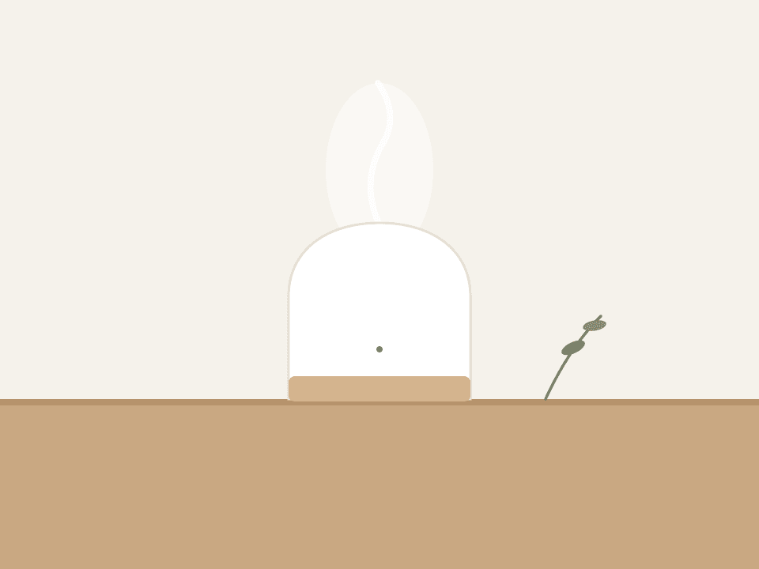
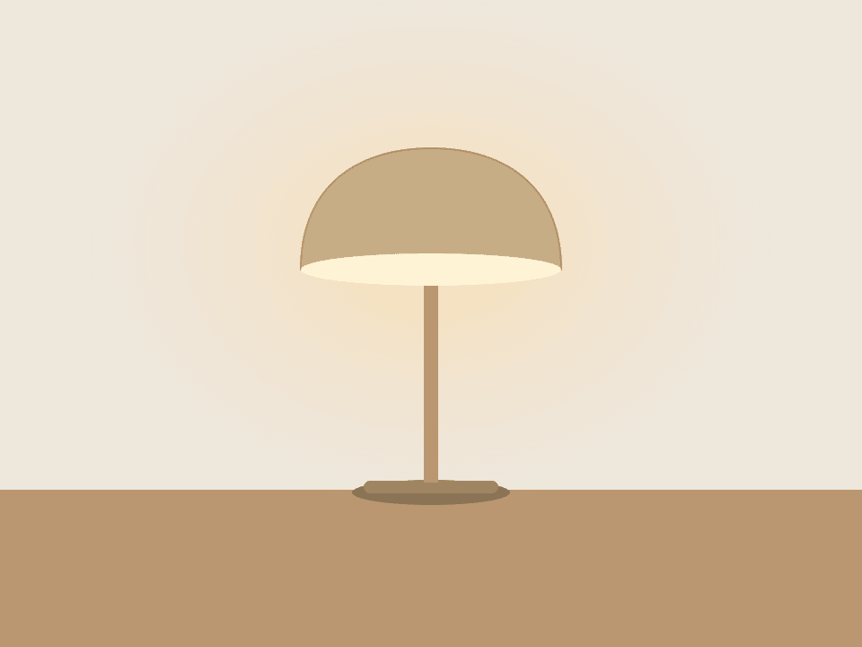
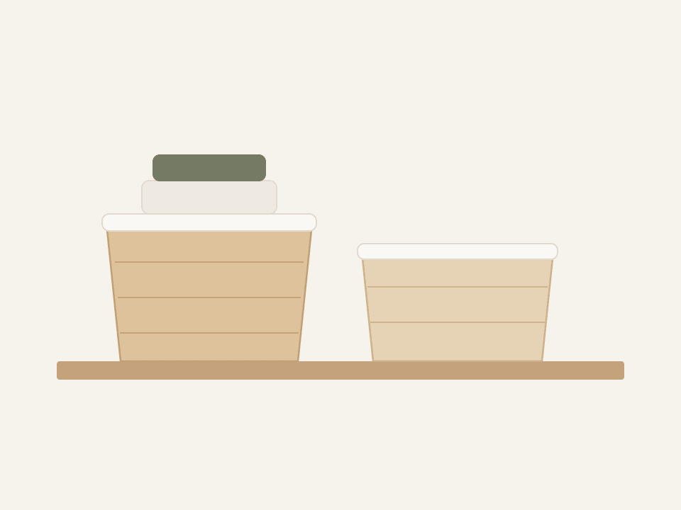
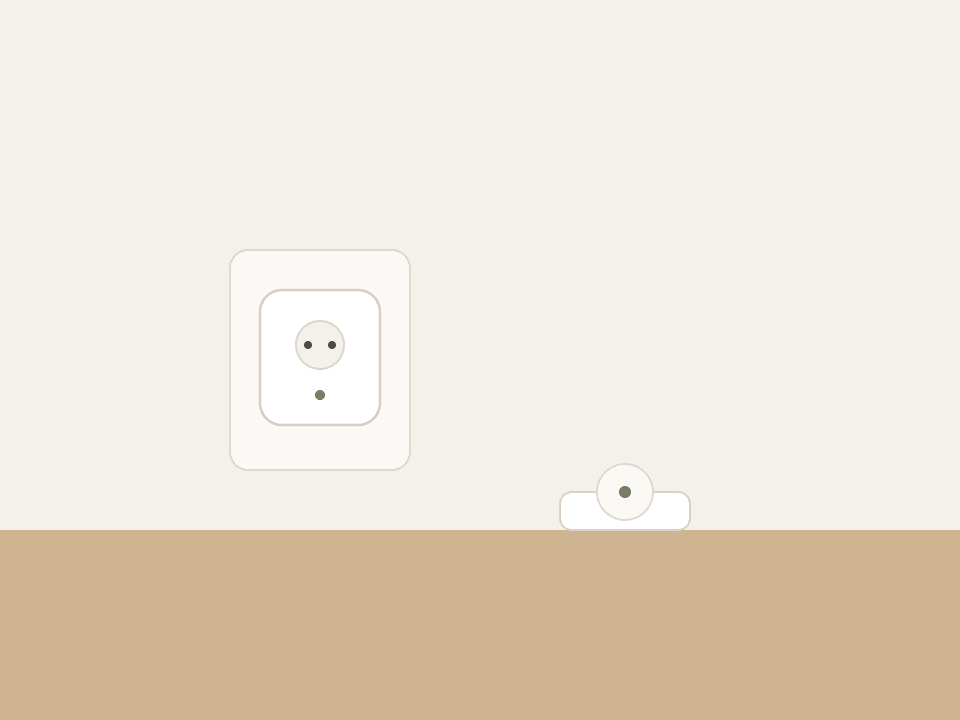
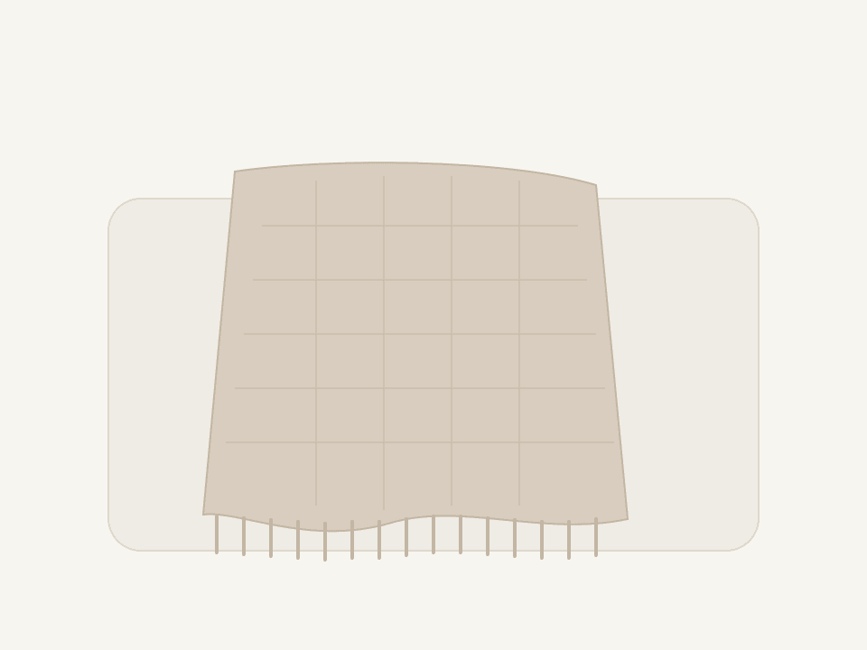
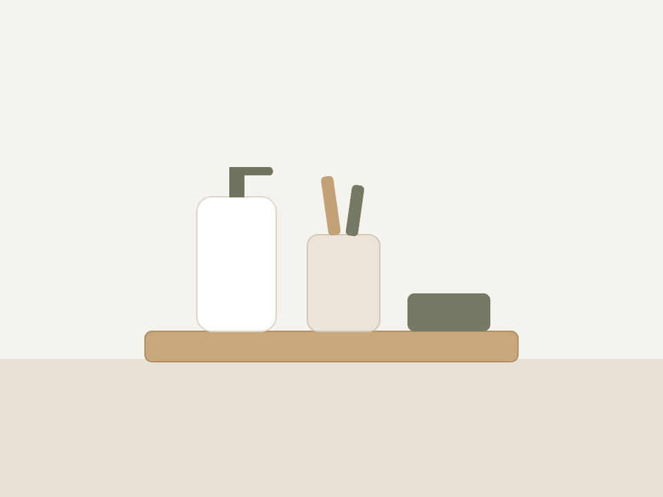
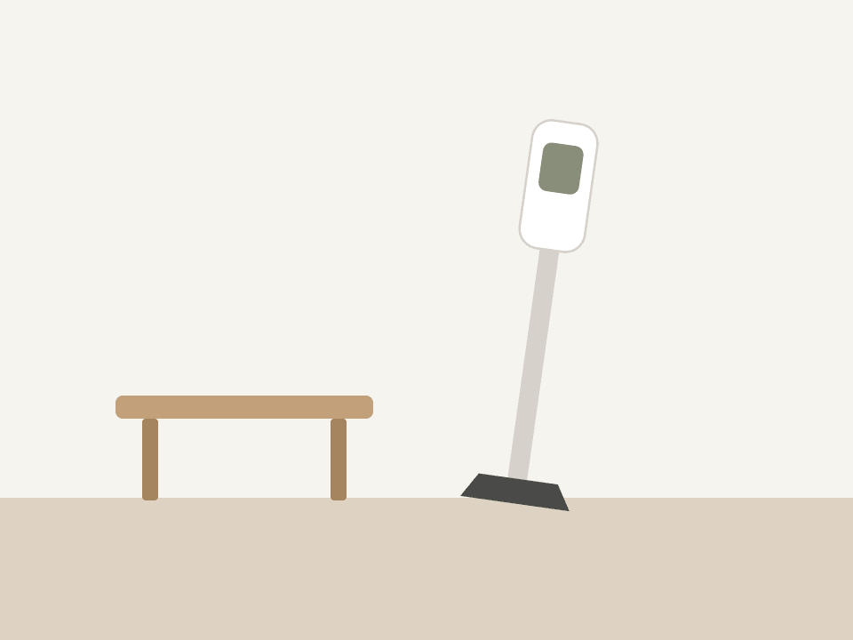

Construir um lar mais gostoso de viver raramente exige reformas caras ou grandes trocas de móveis. Na maioria das vezes, a sensação de bem-estar nasce de ajustes discretos: uma luz mais suave no fim da tarde, o ar menos seco durante a noite ou um lugar definido para guardar o que sempre fica espalhado pela sala.

Reunimos abaixo **sete escolhas práticas e atemporais**, divididas por diferentes áreas da casa, que ajudam a transformar a rotina sem pesar o visual dos ambientes.

> **Nota editorial:** os links externos citados ao longo deste artigo modelo são **demonstrativos**, criados para ilustrar como futuras recomendações e guias de compra funcionam no CasaBoa.

---

## 1. Climatização: Umidificador e Difusor Ultrassônico em Cerâmica

Em boa parte do ano — especialmente quando o ar-condicionado ou o ventilador ficam ligados por horas — o ar dentro de casa tende a ficar seco. Isso aparece na garganta raspando ao acordar e na sensação de cansaço logo cedo.

Um **umidificador ultrassônico com acabamento fosco** resolve o problema com discrição sobre a mesa de cabeceira ou escrivaninha. Modelos silenciosos permitem dormir sem ruídos constantes e ainda aceitam algumas gotas de óleo essencial apenas para perfumar suavemente o quarto.

- **Principal benefício:** melhora a qualidade do descanso e o conforto respiratório em dias secos.
- **Onde funciona melhor:** quartos e escritórios domésticos fechados.
- **Link demonstrativo:** [Conhecer o umidificador em cerâmica (link de demonstração)](https://exemplo.casaboa.blog.br/produto/umidificador-ceramica)

---

## 2. Iluminação: Luminária de Mesa Sem Fio com Luz Quente

Poucas mudanças transformam tanto um ambiente quanto desligar a luz branca do teto à noite e acender apenas pontos de iluminação indireta. A temperatura de cor quente (por volta de **2700K**) sinaliza ao corpo que o dia está desacelerando.

Uma **luminária portátil recarregável** elimina a dependência de tomadas livres. Você pode levá-la do aparador da sala para a mesa de jantar ou para a cabeceira conforme o momento do dia, mantendo o visual limpo e sem fios aparentes.

- **Principal benefício:** cria atmosfera acolhedora instantânea em qualquer canto da casa.
- **Fique atento a:** presença de regulador de intensidade (dimmer) e autonomia de bateria acima de 8 horas.
- **Link demonstrativo:** [Ver luminária portátil sem fio (link de demonstração)](https://exemplo.casaboa.blog.br/produto/luminaria-sem-fio)

---

## 3. Organização: Cestos em Fibra Natural e Forro de Linho

Mesmo os ambientes mais arrumados acumulam objetos de uso diário: controles remotos, carregadores, mantas dobradas ou brinquedos. Deixar tudo exposto em prateleiras cria ruído visual imediato.

Os **cestos em fibra natural com forro removível de linho** cumprem duas funções ao mesmo tempo: organizam o volume solto em categorias claras e aquecem a decoração com textura orgânica. O forro interno também evita que tecidos delicados desfiem em contato com a palha.

- **Principal benefício:** reduz a poluição visual e facilita guardar tudo em segundos.
- **Dica prática:** escolha tamanhos modulares que caibam exatamente na profundidade do seu rack ou estante.
- **Link demonstrativo:** [Ver conjunto de cestos organizadores (link de demonstração)](https://exemplo.casaboa.blog.br/produto/cestos-fibra-natural)

---

## 4. Tecnologia: Tomada Inteligente Compacta

Automatizar a casa não precisa significar telas espalhadas pelas paredes ou configurações complicadas. Uma simples **tomada inteligente Wi-Fi** já resolve pequenas tarefas repetitivas com discrição.

Conectada a um abajur da sala, ela pode acender automaticamente às 18h30 e desligar perto da hora de dormir. Na cozinha, permite ligar a cafeteira antes mesmo de sair da cama — usando o mesmo aparelho que você já tem.

- **Principal benefício:** traz praticidade real sem precisar substituir eletrodomésticos antigos.
- **Observação:** dê preferência a modelos compactos que não bloqueiem a tomada vizinha no espelho da parede.
- **Link demonstrativo:** [Explorar tomada inteligente compacta (link de demonstração)](https://exemplo.casaboa.blog.br/produto/tomada-inteligente)

---

## 5. Conforto: Manta em Algodão Waffle e Linho

Texturas naturais mudam a forma como percebemos um sofá ou uma cama. Uma manta leve em **algodão com trama waffle** (aquele relevo suave em pequenos quadrados) oferece aconchego sem esquentar demais, sendo muito adequada ao clima brasileiro.

Além do conforto tátil nas noites de filme ou leitura, ela ajuda a proteger o estofado em áreas de maior uso e pode ser lavada facilmente em casa.

- **Principal benefício:** conforto térmico equilibrado e camada extra de aconchego visual.
- **Cores versáteis:** aveia, off-white, bege areia e verde oliva suave combinam sem esforço.
- **Link demonstrativo:** [Ver manta em algodão waffle (link de demonstração)](https://exemplo.casaboa.blog.br/produto/manta-algodao-waffle)

---

## 6. Cozinha: Bandeja de Bambu com Dispensador em Cerâmica

A bancada da pia costuma ser o ponto onde a cozinha parece desorganizada mais rápido: embalagem colorida de detergente, esponja molhada e paninho fora do lugar.

Agrupar esses itens em uma **bandeja resistente à umidade com dispensador recarregável** padroniza o visual e facilita na hora de passar um pano na pedra. É uma troca pequena que muda a primeira impressão de toda a cozinha.

- **Principal benefício:** deixa a área da pia organizada, higiênica e visualmente calma.
- **Link demonstrativo:** [Conhecer kit organizador de bancada (link de demonstração)](https://exemplo.casaboa.blog.br/produto/kit-bancada-cozinha)

---

## 7. Limpeza: Aspirador Vertical Sem Fio Leve

Manter a casa limpa durante a semana fica muito mais simples quando você não precisa desenrolar cabos longos nem carregar um aparelho pesado do fundo da lavanderia.

Um **aspirador vertical sem fio leve** incentiva pequenas passadas rápidas de cinco minutos após o café ou no fim do dia, evitando que migalhas, poeira e pelos se espalhem pelo restante da casa.

- **Principal benefício:** transforma a limpeza pesada de fim de semana em manutenção leve diária.
- **O que observar:** peso abaixo de 2,5 kg e reservatório fácil de esvaziar com um clique.
- **Link demonstrativo:** [Ver aspirador vertical sem fio (link de demonstração)](https://exemplo.casaboa.blog.br/produto/aspirador-vertical-leve)

---

## Como começar sem exageros

Você não precisa adquirir tudo de uma só vez. Observe qual pequeno incômodo aparece com mais frequência na sua rotina — pode ser a luz forte demais à noite, o ar seco no quarto ou a pia sempre carregada — e comece por uma única escolha.

Aos poucos, essas decisões silenciosas constroem uma casa mais leve, organizada e verdadeiramente prazerosa de habitar.
